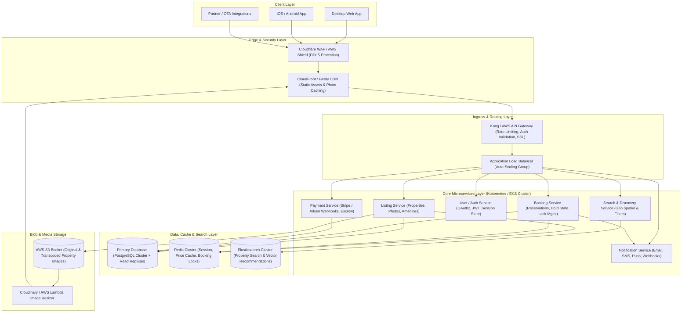

# Production Architecture Diagram: Vacation Rental Marketplace

This document presents a production-grade, highly reliable microservice architecture for a vacation-rental marketplace like **HavenScape**.

---

## 1. High-Level Architecture Diagram (Mermaid)



---

## 2. Text/ASCII Visual Diagram

```
+-------------------------------------------------------------------------+
|                              END USERS                                  |
|         [ Desktop Browser ]   [ Mobile Apps ]   [ OTA API Partners ]    |
+-------------------------------------------------------------------------+
                                     |
                                     v
+-------------------------------------------------------------------------+
|                         EDGE & SECURITY LAYER                           |
|        Cloudflare / AWS Shield WAF (DDoS, Bot Protection, Rate Limit)    |
|        Global Edge CDN (Cached Property Photos, Static Assets)          |
+-------------------------------------------------------------------------+
                                     |
                                     v
+-------------------------------------------------------------------------+
|                       INGRESS & ROUTING LAYER                           |
|        Kong API Gateway / AWS ALB (OAuth Token Validation, SSL)         |
+-------------------------------------------------------------------------+
                                     |
                                     v
+-------------------------------------------------------------------------+
|                     BACKEND MICROSERVICES LAYER                         |
|                                                                         |
|  +------------------+  +------------------+  +-----------------------+  |
|  | Listing Service  |  | Booking Service  |  | User / Auth Service   |  |
|  | - Metadata       |  | - Calendar Lock  |  | - JWT / Sessions      |  |
|  | - Gallery API    |  | - Reservation    |  | - Host Verification   |  |
|  +------------------+  +------------------+  +-----------------------+  |
|           |                     |                        |              |
|  +------------------+  +------------------+  +-----------------------+  |
|  | Payment Service  |  | Notif Service    |  | Search Service        |  |
|  | - Stripe / Webhook|  | - Email / SMS    |  | - GeoSpatial / Vector |  |
|  +------------------+  +------------------+  +-----------------------+  |
+-------------------------------------------------------------------------+
           |                      |                        |
           v                      v                        v
+-------------------------------------------------------------------------+
|                    DATABASES & CACHING LAYER                            |
|  [ PostgreSQL Cluster ]     [ Redis Cluster ]    [ Elasticsearch ]       |
|  (Transactional Data)       (Distributed Locks)  (Geo Spatial Queries)  |
+-------------------------------------------------------------------------+
                                  |
                                  v
+-------------------------------------------------------------------------+
|                     OBJECT STORAGE & MEDIA CDN                          |
|  AWS S3 Bucket (Raw Images) -> Lambda Resizer -> CDN Cache Edge         |
+-------------------------------------------------------------------------+
```

---

## 3. Subsystem Breakdown & Design Rationale

### A. Edge & CDN Layer
- **Cloudflare WAF / AWS Shield**: Prevents DDoS attacks, rate-limits aggressive scrapers, and filters malicious traffic.
- **Global CDN (CloudFront / Fastly)**: Serves static web bundles (Vite assets) and optimizes high-resolution property images near the user with WebP/AVIF automatic format conversion.

### B. API Gateway & Ingress
- **Kong / Envoy Gateway**: Centralized API gateway for rate limiting, JWT validation, request logging, CORS enforcement, and microservice routing.

### C. Core Microservices
1. **Listing Service**:
   - Manages property metadata, amenities, host profiles, pricing rules, and photo mappings.
   - Leverages Redis to cache property details for sub-50ms listing page load times.
2. **Booking & Reservation Service**:
   - Handles double-booking prevention using distributed Redis locks (`Redlock`).
   - Manages reservation states: `PENDING_PAYMENT`, `CONFIRMED`, `CANCELLED`, `COMPLETED`.
3. **User & Auth Service**:
   - Manages traveler and host accounts, OAuth2 authentication, multi-factor auth (MFA), and host identity verification.
4. **Payment Service**:
   - Integrates with Stripe / Adyen APIs. Handles authorization holds, payment capture, host payouts, currency conversion, and escrow logic.
5. **Notification Service**:
   - Async event-driven system (via Apache Kafka or AWS SQS) that sends booking confirmations, SMS check-in reminders, and host alert messages.
6. **Search & Discovery Service**:
   - Uses Elasticsearch / OpenSearch for geo-radius search, price filtering, date availability, and vector-based recommendations.

### D. Data Persistence & Cache Strategy
- **PostgreSQL**: Acid-compliant primary storage for users, listings, reservations, and financial ledgers.
- **Redis Cluster**: Caches hot listing details, active user sessions, rate limits, and temporary 15-minute booking hold locks.
- **Elasticsearch**: Indexing for geo-location bounding boxes, text searches, and feature filtering.

### E. Object Storage for Property Media
- **AWS S3**: Secure object storage for high-resolution property photography.
- **Lambda Image Resizer**: On-the-fly image thumbnailing and optimization pipeline generating 4K, 1080p, 720p, and thumbnail sizes automatically.
